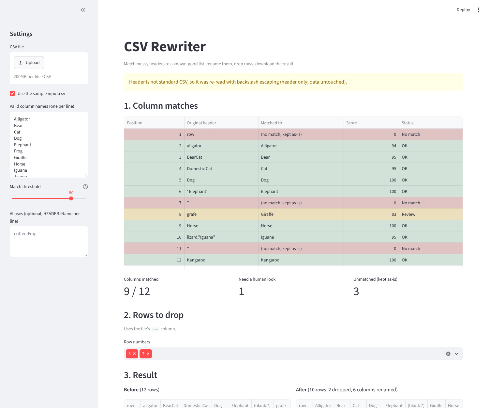

# CSVRewriter

A small Python utility that cleans messy CSV files. It matches column headers to a known-good list (even with typos, odd casing or stray spaces), renames them, drops unwanted rows, and writes the result back out.

The submission includes the code, the sample input and output, 55 tests, a benchmark script, and a write-up of how I used AI (see [AI_USAGE.md](AI_USAGE.md)).

## Setup and run

```bash
python3 -m venv .venv && source .venv/bin/activate
python -m pip install -r requirements.txt
python main.py                  # input.csv -> output.csv (drops rows 3 and 7 as an example)
python -m pytest -q             # 55 tests
python benchmark.py             # timing on a 1,000,000-row synthetic file
streamlit run ui.py             # optional web UI (see below)
```

Other options:

```bash
python main.py --drop 5 10                  # choose which row numbers to drop
python main.py --drop                       # drop nothing
python main.py --dry-run                    # show the matches, write nothing
python main.py --alias "critter=Frog"       # explicit header -> name mapping (repeatable)
python main.py --threshold 90               # stricter matching
python main.py --input a.csv --output b.csv
python main.py --strict                     # fail instead of retrying the header (see below)
```

The header in the supplied file uses a backslash-escaped quote (`lizard,\"Iguana\"`), which is not standard CSV. `python main.py` handles it on its own: it tries standard parsing first, and if the *header* fails, it retries with backslash escaping applied to the header only and prints a warning. Data values are never touched. Use `--legacy-header` to force this up front, or `--strict` to turn the retry off.

The task doesn't say which rows are unwanted, so `--drop 3 7` is just a demonstration default. Replace it with the real requirement.

## Web UI (optional)

`streamlit run ui.py` opens a small front end over the same class: upload a CSV (or tick the sample), see every header's match, score and status (OK / Review / No match), pick rows to drop, compare before and after, and download the cleaned file. It only calls the public `CSVRewriter` methods, so it behaves exactly like the CLI.



## Class interface

`CSVRewriter(file_name, valid_columns, threshold=80, row_column='row', *, header_escapechar=None, aliases=None)`

| Method | Behavior |
| --- | --- |
| `match_columns()` | Returns a `ColumnMatch` for every source column: position, original header, matched name (or `None`), and score. |
| `rename_columns()` | Renames matched columns and returns `{old: new}` for the ones that changed. Unmatched headers stay as they are. Logs a warning if duplicate names result. |
| `drop_rows(row_numbers)` | Drops rows by their `row` value (or 1-based position if there is no `row` column) and returns how many were removed. Logs any row numbers that don't exist. |
| `to_csv(path)` | Writes the current data without an index column. |

```python
from main import CSVRewriter, CARS

rewriter = CSVRewriter("input.csv", CARS, header_escapechar="\\")   # legacy header, explicit
matches = rewriter.match_columns()      # inspect before changing anything
rewriter.rename_columns()
rewriter.drop_rows([3, 7])
rewriter.to_csv("output.csv")
```

## Result on the provided `input.csv`

| Original header | Matched to | Score | How it was matched |
|---|---|---|---|
| `aligator` | Alligator | 94 | typo (fuzzy ratio) |
| `BearCat` | Bear | 95 | CamelCase token; `Domestic Cat` already claims Cat |
| `Domestic Cat` | Cat | 95 | whole-word match |
| `Dog` | Dog | 100 | exact |
| ` Elephant` | Elephant | 100 | whitespace ignored |
| `grafe` | Giraffe | 83 | typo (fuzzy ratio), flagged `<- review` |
| `Horse` | Horse | 100 | exact |
| `lizard,\"Iguana\"` | Iguana | 95 | whole-word match |
| `Kangaroo` | Kangaroo | 100 | exact |
| `row`, *(blank)*, *(blank)* | none | n/a | no match, kept as-is and reported |

The output keeps the matched headers, keeps the unnamed columns, and excludes row identifiers 3 and 7. Other data values and row order are unchanged. No alias is needed for this file.

## Issues found in `input.csv`

- Line 1 is blank (`,,,,`), and the real header is on line 2.
- A backslash-escaped quote sits inside one header (`lizard,\"Iguana\"`).
- ` Elephant` has a leading space.
- Two header cells are empty. They sit where Frog and Jaguar would fall alphabetically, but that is a guess (see Known limitations).
- The `row` column is shuffled, so "row number" can't mean position in the file.

## Matching and data handling

- **Scoring:** exact (100) > explicit alias (99) > whole-word token (95) > fuzzy ratio. Text is normalized first, so case, accents, spacing and punctuation are ignored. CamelCase is split into words (`BearCat` is `bear` + `cat`).
- **One-to-one assignment:** every candidate at or above the threshold is ranked by score (plain fuzzy ratio breaks ties) and assigned greedily, so each valid name is used at most once. That is why `Domestic Cat` gets Cat and `BearCat` falls back to Bear.
- **No substring matching:** `Catalog`, `Bearing` and `Dogma` do not match Cat, Bear or Dog.
- **Aliases** are explicit instructions that beat fuzzy scores but never an exact match, so they can't create duplicate names. An alias is rejected at construction if its key is already a valid name, its target is invalid, or it conflicts with another alias.
- **Data is read as text and never altered:** literal backslashes, leading zeros (`007`), quotes, commas and embedded newlines are preserved. Strict parsing rejects malformed quoting and rows whose width differs from the header, and reports the line number.
- **Header handling:** the first record with any content is the header, so the blank opening line is skipped. The original header text (including whitespace) is kept until `rename_columns()`. A UTF-8 BOM is ignored.
- **Row deletion** uses the `row` column when present (found ignoring case and surrounding whitespace). If several columns match, it raises an error before anything is deleted. Otherwise row numbers mean 1-based data-row positions.
- Scores are heuristic similarities, not probabilities.

## Performance

Measured with `python benchmark.py` on a synthetic 1,000,000-row x 12-column file (35 MB). Times vary by machine; these are rough figures:

| Step | Time |
|---|---|
| Load (strict parse + header detection) | ~1.9 s |
| `match_columns` / `rename_columns` | under 10 ms (depends on columns x valid names, not row count) |
| `drop_rows` | ~0.9 s |
| `to_csv` | ~1.8 s |
| Peak memory | ~600 MB |

Data is read as text on purpose: it keeps values like `007` intact and avoids type-inference surprises, at the cost of memory. Files larger than RAM would need chunked reading and writing.

## Testing

`python -m pytest -q` runs **55 tests**. They cover:

- header matching and original-header preservation
- whole-word vs substring behavior
- one-to-one assignment in both column orders
- thresholds, accents and aliases (including rejected ones)
- row deletion by identifier and by position
- strict parsing, header-only escaping, BOM, empty and header-only files, width mismatches
- full CSV round trips (backslashes, commas, quotes, newlines, leading zeros)
- the CLI: first run with no flags, `--strict`, `--dry-run`, the overwrite guard, and friendly errors

One test regenerates the sample output and compares it byte-for-byte with the committed `output.csv`.

## Generative AI usage

I used Claude (chat) and OpenAI Codex while building this. [AI_USAGE.md](AI_USAGE.md) covers what I used them for, what they got wrong, and the decisions I made myself.

## Known limitations

- Greedy matching doesn't guarantee the best overall pairing on very ambiguous schemas.
- The CLI flags matches below 90 with `<- review`, but a person should confirm them on new schemas.
- The two blank headers stay blank. Filling them by position (Frog, Jaguar) would be a guess; it could be added as an explicit opt-in.
- The whole file is loaded into memory (~600 MB at 1M rows). This is a small-file utility, not a streaming processor.
- Output is UTF-8 and uses the platform's line endings, so it may differ from the CRLF in the sample input.
- Matching is tuned for Latin-script names. Other scripts are compared after Unicode normalization but not specially tuned.

## Future enhancements

- Opt-in positional inference for blank headers
- Chunked read/write for files larger than memory
- `rapidfuzz` as a faster, maintained alternative to fuzzywuzzy
- Alias/synonym lists loaded from a config file
